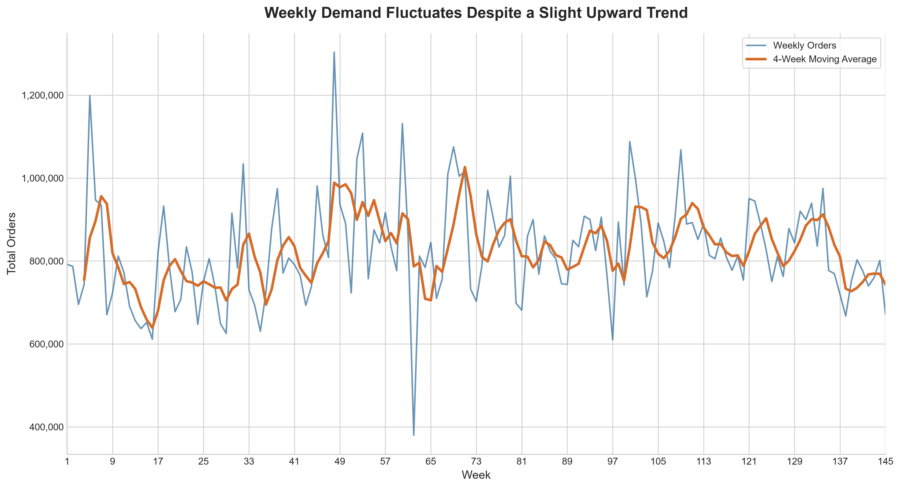
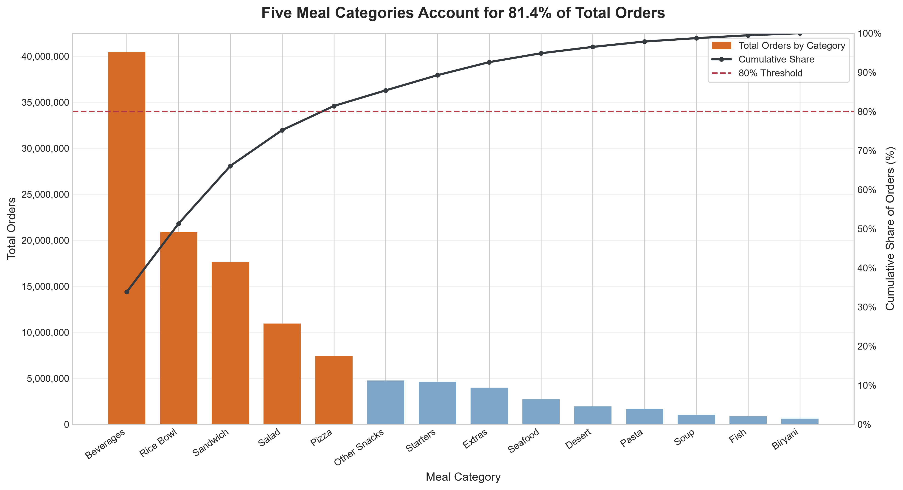
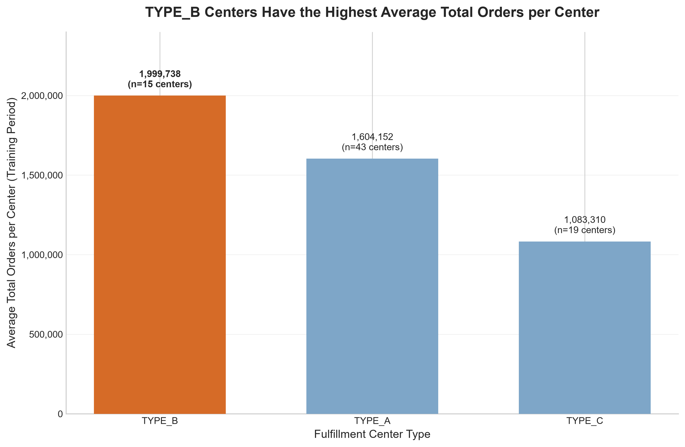
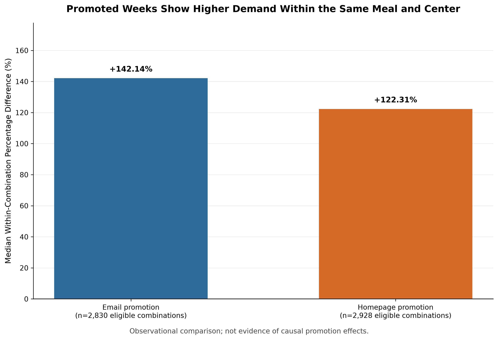

# التقرير النهائي لتحليل الطلب على الوجبات

## 1. الملخص التنفيذي (Executive Summary)

حلّل المشروع 456,548 سجلًا تدريبيًا تغطي الأسابيع المرقمة 1–145، بإجمالي 119,557,485 طلبًا.  
بلغ متوسط الطلب 824,534.38 طلبًا أسبوعيًا، وكان التغير بين متوسط أول 20 وآخر 20 أسبوعًا ارتفاعًا وصفيًا قدره 3.62%، مع تقلب واضح بين الأسابيع.  
مثّلت الفئات الخمس الأعلى طلبًا 81.40% من الطلبات، وبلغت حصة أعلى 22 وجبة 81.18%.  
حقق TYPE_A أكبر إجمالي طلبات، في حين سجل TYPE_B أعلى متوسط إجمالي طلبات لكل مركز؛ كما ارتبطت أسابيع الترويج بطلب أعلى في المقارنات الرصدية داخل الوجبة والمركز.  
تدعم النتائج تحسين التخطيط حسب حجم الطلب والتذبذب، لكنها لا تثبت أن الترويج أو الخصم أو أي خاصية تشغيلية تسبب تغير الطلب.

## 2. هدف المشروع ووصف البيانات

يهدف المشروع إلى وصف اتجاهات الطلب الأسبوعي، ومساهمة فئات الوجبات والوجبات الفردية، وأداء مراكز التوصيل، والأنماط المرتبطة بالترويج والأسعار، وتذبذب الطلب. استُخدمت بيانات التدريب للتحليلات التي تتطلب `num_orders`، مع جداول مرجعية لمعلومات الوجبات ومراكز التوصيل.

يتضمن `train.csv` عدد 456,548 سجلًا للطلب خلال الأسابيع 1–145، ويتضمن `test.csv` عدد 32,573 سجلًا للأسابيع 146–155، دون استخدامه لحساب الطلب لعدم احتوائه على `num_orders`. يحتوي `meal_info.csv` على 51 وجبة، ويحتوي `fulfilment_center_info.csv` على 77 مركزًا. نجحت عمليات الدمج المرجعية من نوع `many-to-one` دون مفاتيح غير مطابقة أو تغير في عدد صفوف التدريب أو مجموع الطلبات. استُخدمت البيانات الأصلية للقراءة فقط.

## 3. مؤشرات الأداء الرئيسية (KPIs)

| المؤشر | النتيجة | التفسير |
|---|---:|---|
| إجمالي الطلبات (Total Orders) | 119,557,485 طلبًا | مجموع `num_orders` في بيانات التدريب |
| متوسط الطلبات الأسبوعي (Average Weekly Orders) | 824,534.38 طلبًا/أسبوع | المتوسط عبر 145 أسبوعًا |
| الإيرادات التقديرية (Estimated Revenue) | 31,922,771,040.11 | مجموع `checkout_price × num_orders`؛ العملة غير محددة |
| متوسط نسبة الخصم (Average Discount) | 5.72% | متوسط حسابي لنسبة الخصم لكل صف، غير موزون بعدد الطلبات |
| معدل الترويج بالبريد (Email Promotion Rate) | 8.12% من الصفوف | نسبة الصفوف التي فيها `emailer_for_promotion = 1` |
| معدل الترويج بالصفحة الرئيسية (Homepage Promotion Rate) | 10.92% من الصفوف | نسبة الصفوف التي فيها `homepage_featured = 1` |
| معدل وجود أي ترويج (Any Promotion Rate) | 14.82% من الصفوف | وجود أحد المؤشرين أو كليهما |
| معامل تقلب الطلب الأسبوعي (Weekly Demand CV) | 15.24% | الانحراف المعياري العيني (`ddof=1`) لمجاميع الطلب الأسبوعية مقسومًا على متوسطها |

الإيرادات تقديرية وليست إيرادات محاسبية مؤكدة. احتُفظ بنسب الخصم السالبة؛ فهي تعبر عن صفوف كان فيها سعر الدفع أعلى من السعر الأساسي.

## 4. نتائج التحليلات الستة

### 4.1 اتجاه الطلب الأسبوعي

تفاوت إجمالي الطلب من أسبوع إلى آخر. بلغ أعلى طلب 1,303,457 في الأسبوع 48، وأدنى طلب 380,065 في الأسبوع 62. ارتفع متوسط آخر 20 أسبوعًا (805,151.00 طلبًا) عن متوسط أول 20 أسبوعًا (777,058.20 طلبًا) بنسبة 3.62%. كان ارتباط Spearman بين رقم الأسبوع والطلب الأسبوعي موجبًا وضعيفًا (`ρ = 0.1697`, `p = 0.04123`)؛ وهو وصف للترابط ولا يثبت اتجاهًا سببيًا.

### 4.2 تحليل Pareto للفئات والوجبات

بلغ عدد الفئات 14. تصدرت فئة Beverages بإجمالي 40,480,525 طلبًا (33.86%). وصلت أول خمس فئات إلى 81.40% من الطلبات. ومن أصل 51 وجبة، احتاج بلوغ 80% إلى أول 22 وجبة، التي ساهمت فعليًا بنسبة 81.18%؛ لذا لا تنطبق قاعدة «20% من الوجبات تحقق 80%» على هذه البيانات.

### 4.3 أداء مراكز التوصيل

| نوع المركز | إجمالي الطلبات | عدد المراكز | متوسط إجمالي الطلبات لكل مركز |
|---|---:|---:|---:|
| TYPE_A | 68,978,517 | 43 | 1,604,151.56 |
| TYPE_B | 29,996,073 | 15 | 1,999,738.20 |
| TYPE_C | 20,582,895 | 19 | 1,083,310.26 |

كان إجمالي طلبات TYPE_A الأعلى، ويرتبط ذلك أيضًا بامتلاكه عددًا أكبر من المراكز؛ أما TYPE_B فسجل أعلى متوسط لكل مركز. بلغت حصة أعلى 10 مراكز 25.93% من الطلبات. وبلغ ارتباط Spearman بين مساحة التشغيل `op_area` وإجمالي طلبات المركز `ρ = 0.6884` (`p ≈ 4.56×10⁻¹²`) عبر 77 مركزًا؛ لا يدل ذلك على السببية.

### 4.4 العلاقة بين الترويج والطلبات

في المقارنة العامة، بلغ متوسط الطلب في صفوف الترويج بالبريد 631.10 مقابل 229.26 دون الترويج، أي فرق وصفي +175.27%. وبلغ متوسط الصفحات المميزة 594.88 مقابل 221.05، أي +169.12%.

عند المقارنة داخل تركيبات `(meal_id, center_id)` التي ظهرت في الحالتين، كان وسيط نسبة فرق متوسط الطلب +142.14% للبريد ضمن 2,830 تركيبة مؤهلة، و+122.31% للصفحة الرئيسية ضمن 2,928 تركيبة. هذه مقارنة رصدية وليست تقديرًا سببيًا؛ فقد تزامن العرضان في 19,231 صفًا.

أُجري اختبار Mann–Whitney U ثنائي الطرف على مشاهدات الأسابيع المجمعة داخل التركيبات المؤهلة. بلغت قيمة U للبريد 8,740,582,324.5 وللصفحة الرئيسية 11,694,179,707.5. كانت النتيجة `p < 1e-300 (numerical underflow)`؛ والقيمة الصغيرة جدًا ناتجة عن حدود الدقة العددية، ولا تعني أن الاحتمال يساوي صفرًا حرفيًا. الاختبار استكشافي، إذ لا يعالج الاعتماد بين المشاهدات المتكررة أو الموسمية أو العوامل المربكة.

### 4.5 العلاقة بين الخصومات والطلبات

بلغ ارتباط Spearman بين نسبة الخصم والطلب عبر جميع الصفوف `ρ = 0.1218`، وهو ارتباط موجب ضعيف. اختلفت العلاقة حسب الفئة: سجلت Pizza ارتباطًا موجبًا أقوى (`ρ = 0.5401`)، وسجلت Extras ارتباطًا سالبًا (`ρ = -0.2661`)، بينما كان ارتباط Soup قريبًا من الصفر (`ρ = 0.0033`, `p = 0.7111`). تبقى هذه علاقات وصفية؛ فقد تتداخل معها فئة الوجبة والترويج والسعر وعوامل أخرى.

### 4.6 تقلب الطلب باستخدام معامل الاختلاف (CV)

حُسب CV لكل وجبة ومركز باستخدام الأسابيع المرصودة فقط والانحراف المعياري العيني (`ddof=1`). كانت الوجبة 2444 الأعلى تذبذبًا (`CV = 120.50%`)، والوجبة 1803 الأكثر استقرارًا نسبيًا (`CV = 14.60%`). وعلى مستوى المراكز، سجل المركز 91 أعلى CV (`34.21%`)، والمركز 13 أدناه (`12.32%`). بلغ وسيط CV للوجبات 45.98%. بلغ ارتباط Spearman بين إجمالي الطلب وCV مقدار `ρ = 0.0814` للوجبات و`ρ = -0.4454` للمراكز. لا يمثل CV وحده حجم الأهمية أو الطلب؛ وقد يرتفع عند انخفاض المتوسط.

## 5. الرسومات البيانية

### اتجاه الطلب الأسبوعي

### تحليل Pareto لفئات الوجبات

### أداء مراكز التوصيل حسب النوع

### المقارنة الرصدية للترويج والطلب

## 6. التوصيات العملية

1. **تركيز تخطيط التوافر على الفئات الأعلى مساهمة.** ابدأ بمراجعة التنبؤ والتوافر التشغيلي لفئات Beverages وRice Bowl وSandwich وSalad وPizza، التي تمثل مجتمعة 81.40% من الطلبات. **مؤشر القياس:** معدل توافر الأصناف أو معدل نفاد المخزون حسب الفئة، مع متابعة الطلبات المفقودة عند توفر بياناتها. لم يُقاس معدل النفاد في هذا التحليل؛ وأي هدف رقمي له ينبغي تحديده كهدف مستقبلي بعد إنشاء خط أساس موثوق.
2. **تخطيط السعة على مستويين: إجمالي النوع ومتوسط المركز.** خذ في الحسبان أن TYPE_A حقق 68,978,517 طلبًا إجمالًا، بينما سجل TYPE_B متوسطًا أعلى قدره 1,999,738.20 طلبًا لكل مركز؛ لذلك لا يكفي ترتيب الأنواع وفق إجمالي الطلب وحده. **مؤشر القياس:** إجمالي الطلبات لكل مركز، ومتوسطها حسب نوع المركز، مع مراقبة مستوى الخدمة أو زمن التلبية إذا توفرت بيانات تشغيلية مناسبة. تُحدد أهداف التحسين المستقبلية بعد مراجعة السعة الحالية وخط الأساس.
3. **اختبار العروض بتجربة قابلة للتقييم السببي قبل توسيعها.** أظهرت المقارنات الرصدية وسيط فرق داخل التركيبة قدره +142.14% للبريد و+122.31% للصفحة الرئيسية، لكنها لا تعزل أثر الترويج. نفّذ تجربة مضبوطة أو تصميمًا تجريبيًا مناسبًا مع تسجيل التداخل بين العروض. **مؤشر القياس:** الزيادة الإضافية في الطلب (incremental order lift) وصافي الهامش مقارنة بمجموعة ضابطة. تُحدد عتبة النجاح وحجم التجربة كأهداف مستقبلية قبل البدء، ولا تُعامل النسب الرصدية الحالية كهدف أو أثر متوقع مضمون.
4. **إدخال تذبذب الطلب في تخطيط الوجبات.** تختلف قيم CV بوضوح؛ فالوجبة 2444 سجلت 120.50% مقابل 14.60% للوجبة 1803. راجع الوجبات ذات CV الأعلى للتأكد من ملاءمة التنبؤ ومخزون الأمان دون افتراض أن التذبذب يعني خطأ في البيانات. **مؤشر القياس:** CV على الأسابيع المرصودة، إلى جانب دقة التنبؤ ومعدل التوافر. تُحدد أهداف خفض الخطأ أو CV مستقبلًا بعد بناء خط أساس تشغيلي ومراعاة اختلاف حجم الطلب.

## 7. حدود التحليل (Limitations)

- أرقام الأسابيع مؤشرات تسلسلية، وليست تواريخ تقويمية محددة.
- رموز المدن والمناطق قيم تعريفية، وليست أسماء جغرافية.
- الارتباطات والمقارنات الإحصائية لا تثبت السببية؛ ومقارنات الترويج استكشافية، مع اعتماد محتمل بين المشاهدات المتكررة.
- لا تظهر بعض الوجبات أو المراكز في جميع الأسابيع. استُبعدت الأسابيع غير المرصودة من حساب CV بدل افتراض أنها صفر طلبات.
- عملة الأسعار غير محددة، لذلك الإيرادات تقديرية بوحدات سعر غير محددة وليست إيرادات محاسبية مؤكدة.
- متوسط الخصم محسوب على مستوى الصفوف وليس مرجحًا بعدد الطلبات. وقد ترتبط الأسعار والخصومات بمزيج الوجبات والترويج وعوامل أخرى.

## الإضافة الاختيارية: التنبؤ بالطلب باستخدام التعلم الآلي

### الهدف

التنبؤ بعدد الطلبات للأسابيع 146–155 لمساعدة الشركة في التخطيط للمشتريات والمخزون.

### المنهجية

- تدريب النماذج على بيانات الأسابيع 1–135، ثم تقييمها على الأسابيع 136–145.
- مقارنة خط أساس ساذج (Naive Baseline) مع نموذج Random Forest باستخدام متوسط الخطأ المطلق (MAE).
- إعادة تدريب Random Forest على بيانات الأسابيع 1–145.
- استخدام بيانات `test.csv` لإنشاء التوقعات للأسابيع 146–155.

### النتائج

- MAE لخط الأساس الساذج: **110.3495** طلبًا.
- MAE لنموذج Random Forest: **69.4827** طلبًا.
- التحسن النسبي في MAE مقارنة بخط الأساس: **37.0339%**.
- عدد التوقعات النهائية: **32,573**.
- حُفظت التوقعات في [reports/predictions.csv](predictions.csv).

### الفائدة العملية للعميل

يمكن استخدام التوقعات لتقدير احتياجات كل مركز من الوجبات والمواد الخام أسبوعيًا، مع متابعة الفروقات بين الطلب المتوقع والفعلي لدعم مراجعة خطط الشراء والمخزون.

### القيود

- اقتصر التقييم على فترة زمنية واحدة (الأسابيع 136–145)، لذلك لا يبيّن أداء النموذج عبر فترات زمنية متعددة.
- لا تضمن نتائج التقييم دقة التوقعات المستقبلية.
- نموذج Random Forest محدود في استقراء الاتجاهات الزمنية خارج نطاق الأسابيع التي تدرب عليها.

## 8. الخاتمة

يُظهر التحليل حجمًا كبيرًا من الطلب مع تركز ملحوظ في عدد محدود من فئات الوجبات، واختلافًا بين إجمالي الطلب حسب نوع المركز ومتوسط الطلب لكل مركز، وتباينًا واسعًا في تقلب الوجبات. تساعد هذه النتائج على توجيه مراجعة التوافر والسعة والتنبؤ، بينما ينبغي اختبار القرارات المتعلقة بالعروض تجريبيًا قبل نسب أي تغير في الطلب إليها. وتبقى كل الاستنتاجات ضمن حدود البيانات الرصدية وتعريفاتها.
